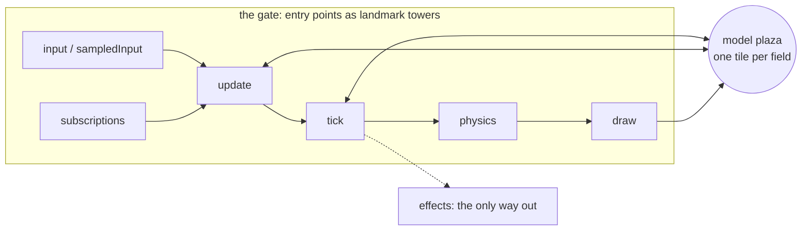
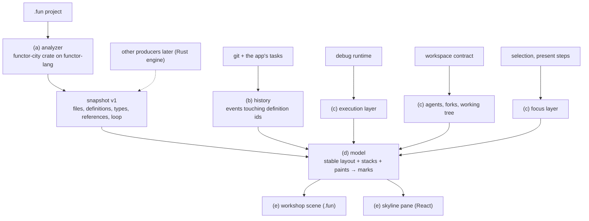

# The code city, for Functor Lang

A design for a code city of a Functor project: a map of its definitions that
shows history, execution, agents and forks (D33, D44, D46 in
[`ideas/ai/desktop-app-revisions-v1.md`](ideas/ai/desktop-app-revisions-v1.md)).
Nothing here is built. Estimates are marked as such; where the code was not
read closely enough to be sure, the text says so.

Contents: [1 principles](#1-principles) ·
[2 what Functor Lang buys](#2-what-constraining-to-functor-lang-buys) ·
[3 the mapping](#3-the-mapping) · [4 architecture](#4-architecture) ·
[5 rendering](#5-rendering-it-well-as-a-functor-app) · [6 diagrams](#6-files-may-draw-themselves) ·
[7 feasibility](#7-feasibility-and-cost) · [8 plan](#8-a-phased-plan) ·
[9 open questions](#9-open-questions)

## 1. Principles

| Principle | Why | Where |
|---|---|---|
| **The definition is the unit**, not the file | Functor projects are 1–25 files. History, paint and references per file would leave a small game with nothing to say. | §2, §3 |
| **Geometry carries slow facts; light and motion carry live ones** | A map is learnable only if it does not move. A mode, a frame or an agent never moves a building. | §3 |
| **A stable layout** | With hot reload the user watches the city while typing. Position must survive edits, not only mode switches. | §4d |
| **A source-neutral snapshot** between analysis and everything else | The analyzer is the only part that knows the language. The engine (Rust) can become a subject later by adding a producer. | §4a |
| **Layers keyed by stable ids** | History, execution, agents and forks are separate streams with their own sources and rates. Each can be absent; "not measured" differs from zero. | §4b–c |
| **One model, several renderers; renderers decide no colours** | The workshop scene and the flat skyline cannot drift, and a new overlay reaches both at once. | §4d–e |
| **Geometry and paint are separate passes** | An overlay repaints; it never re-lays-out. Three grades of change: repaint (colour), refill (instances), rebuild (a new snapshot). | §4d, §5 |
| **Motion only for data** | A dot moves because a call happened. Nothing animates for decoration. | §3 |
| **Walkthroughs are validated data** that only call verbs the city already has | An agent writes them. Nothing in one is markup or code; it is bounded and checked where it lands. | §4f |
| **Inputs from files and agents are untrusted** | Reject, never repair; rebuild from checked fields; cap sizes. | §4 |
| **Labels are the scarce mark** | Few, chosen by the model, to a stated budget. | §3 |
| **The skyline stays a map** | Bars in file and source order, never sorted by a metric; aggregated to the deepest level that fits; one fold stride for the whole row so heights stay proportional. | §4e |

Not wanted: commit-type colours and churn heat ramps (who and which task
matters more here, and heat competes with execution light for brightness);
animated arcs along static edges; fog, bloom and long camera flights (the
city sits on a desk under passthrough and the user moves their head); a
review queue (the decision page and the changes view own review: D31, D35).

## 2. What constraining to Functor Lang buys

| Benefit | What exists today | What must be added |
|---|---|---|
| **Exact definitions and kinds** | `functor_lang::project::load` gives one lowered `Module` for the project: `defs` (name, span, optional annotation, value) and `types` (name, params, body: record fields or variants), plus `InlineModule { name, file, path, span }` and a `SourceMap` from project-wide offsets to files (`functor-lang/src/ir.rs`, `project.rs`). A def whose value is a lambda is a function; anything else is a value. No heuristics. | A walk that lists them. The language server has no `documentSymbol` today; it could be served from the same list. |
| **Types and their shapes** | Record fields and ADT variants are in `TypeDef.body`; the checker's `ExprTypes` gives every expression's type; hover renders signatures. | Nothing for fields and variants. A rendered signature per def (reuse hover's). |
| **A precise reference graph** | Lowering resolves every name: `ExprKind::Global(name)` is a reference to a top-level def, with a span. `functor_lang::reuse` already walks each def for these (`Shape.refs`), but only the transitive closure is public (`CodeIndex::deps_of`). `functor_lang::goto` resolves constructor uses and type names in annotations to their declarations. | A public direct-reference accessor that keeps the reference **sites** (offsets), and the same for constructor and type-annotation uses. There is no reference index in the language server to reuse. |
| **Semantic change detection** | `reuse::shape_of` hashes a def's lowered code ignoring spans and binding ids. Two versions of a def with the same hash are the same code, whatever moved or was reformatted. | Expose it; make the hash stable across builds (it uses `DefaultHasher`) or version the cache. Gives exact per-definition history and rename detection (same shape, new name). |
| **The program has one shape** | Entry points are looked up by name (`init`, `input`, `sampledInput`, `mouseMove`, `mouseWheel`, `mouseButton`, `update`, `subscriptions`, `tick`, `physics`, `draw`, `soundScape`, `ui`), per role for multi-entry projects. The model is one plain value. Effects and subscriptions are values returned from those functions. | Tag entry points in the snapshot; name the model's type (the type of `init`). The city can then draw the loop itself rather than only folders. |
| **Execution data per frame** | See below. | See below. |
| **Time travel** | The debug runtime can seek to a recorded frame; `/trace` then reports coverage relative to the scrubbed frame, with positive offsets for frames after it (`docs/debug-runtime.md`, `docs/time-travel.md`). | A cheaper per-frame request than the full `/trace` (below). |
| **Hot reload** | The producer reparses and rechecks on save, keeps the model, and keeps unchanged values (`functor_lang::reuse`). `/trace.sources` carries a content hash per file. | Re-run the analyzer on the reloaded module and emit which definition ids were added, removed or changed, so the city updates in place. |
| **Small projects** | `examples/hello`: 34 defs, 7 types, 2 files. `orbs`: 32 / 8 / 1. `netpong`: 56 / 10 / 4. `asteroids`: 82 / 2 / 4. `vr-lab`: 1064 / 83 / 22 files (counts of top-level `let` and `type` lines). | The whole city of a typical game fits the mark budget with definitions as buildings (§3). Only vr-lab-sized projects need aggregation. |
| **The engine as a later subject** | — | Out of scope for this analyzer. The snapshot names its language and its kinds, so a Rust producer can emit the same schema; the model, layers and renderers do not change (§4a). |

### Execution data: what it really is

Read from `functor-lang/src/eval.rs` (`Recorder`, `call_recorded`,
`call_covered`), `functor-lang/src/coverage.rs`,
`runtime/functor-runtime-common/src/inspector.rs` and the desktop producer.

| Question | Answer |
|---|---|
| Granularity | **Per expression**: the span start of every expression evaluated. Finer than a line; the editor reduces it to lines (`tools/functor-lang-lsp/src/inspector.rs` `coverage_lines`, pushed as `functor/inspector/coverage`). A definition is covered when any start inside its span is. |
| What is recorded | A **set** per call: ran or did not. No counts, no order, no caller. Capped at 100,000 starts. |
| When | **Only while paused.** While playing the interpreter's recorder is off (one `None` test per evaluation) and `/trace` answers `{ "paused": false }`. Coverage is produced at pause time by **replaying** the journaled entry-point calls (`tick`, `update`, input) with a coverage-only recorder. |
| Window | The paused frame plus a ring of the last 120 frames' journals (`COVERAGE_RING_FRAMES`). Each start lists the frame offsets it ran on; offsets are positive when scrubbed behind the live head. |
| `draw` | Replayed for the paused frame only; other frames' draw passes are not (their models are not journaled). |
| Could-run set | `runnable`: every expression start, statically, so "can run but did not" differs from "not code". |
| Cost | One `/trace` build replays up to 120 frames of game logic plus one values replay of the paused frame; the document is cached until the frame, the scrub position or the program changes. |

So per-definition and per-line execution light **while paused or scrubbing is
available now**, exactly. Two things are not:

- **Call edges.** Nothing records who called whom. But a call edge A → B is a
  reference site inside A, and that site's start is in the coverage set when
  it was evaluated. With reference sites in the snapshot, "A used B on this
  frame" is a join against existing data, with no runtime change: one dot per
  pair per frame, which is the unit wanted. It cannot count calls, and it
  counts passing B as a value as a use. To confirm: that no other expression
  shares a reference's start offset without evaluating it.
- **Full speed.** There is no live signal. Options, cheapest first:
  (a) sample — every N frames replay the last frame coverage-only off the hot
  path and publish per-definition bits (cost ≈ one extra frame of logic per
  sample, no interpreter change); (b) counters at call boundaries only — one
  increment per function call into a per-definition array, and per
  (caller, callee) pair for edges; (c) the per-expression recorder left on
  with a bitset instead of a hash set. (b) is the candidate; S10 measures it.

## 3. The mapping

**Principle (kept from the first proposal):** geometry carries slow facts;
light and motion carry live ones. The city must not reshuffle.

| Channel | Carries | Changes when |
|---|---|---|
| Position | Which file, which module, source order | A definition is added or removed |
| Footprint | Size of the definition's code | An edit crosses a size step |
| Height | History: one slab per change | A change is kept |
| Shape | Kind: function, type, constant, module, entry point | Never for a given definition |
| Hue | Who made each slab (agent or person); a fork's colour on floating work | A change is kept; a fork starts or settles |
| Brightness | Execution: ran on this frame, ran recently, can run but did not | Every frame |
| Motion | Calls (dots), agents (figures) | Every frame |

### Footprint

| Option | Easy to see | Hides |
|---|---|---|
| **Lines of the definition's span** (recommended; the owner's decision) | Where the code is; matches what the editor shows | Density; a long literal table looks important |
| Count of runnable expressions | Amount of logic, immune to formatting and comments | Not what the user sees in the file; unfamiliar unit |
| Uniform lots | The loop and the references, undistorted | Size entirely |
| Fan-in (how many use it) | Central definitions | Position stability: fan-in changes when *other* code changes |

Refinement: area ∝ lines, snapped to steps of ×√2 with hysteresis, so typing
inside a function does not move its neighbours until it crosses a step (§4d).

### Height

| Option | Easy to see | Hides |
|---|---|---|
| **Strata: a slab per change that touched the definition** (recommended; the owner's decision) | What keeps being reworked; who did it; age, as slab order | Size (in footprint instead); nothing for a project with no history yet |
| Lines of code (classic) | Big functions | Doubles footprint; no history anywhere |
| Fan-in or call depth | Structure | Reshapes when other code changes |
| Execution count | Hot code | It is a live fact in a slow channel: the skyline would bounce |

A "change" is a kept task (or a commit made outside the app) whose version of
the definition differs **semantically** from the one before (shape hash), so
formatting and moves add no slab. A fork's uncommitted work is a slab floating
above the stack in the fork's colour until kept, when it settles.
Slabs fold with one stride for the whole city once the tallest stack passes
the visible cap, so heights stay proportional.

### Colour

| Option | Easy to see | Hides |
|---|---|---|
| **Slab hue = who made the change; neutral for people and for history from before the app** (recommended) | Which agent built what; mixed authorship of one function | Kind (carried by shape instead) |
| Hue = kind | Functions against types at a glance | Authorship; and shape already says it |
| Hue per task | One task's footprint across the city | Does not scale: hues run out after about six tasks |
| Heat (churn) | Hotspots | Already said by height |

### Roads and traffic

v1, as decided: **no drawn road network. A dot travels from caller to callee
when the call happens.** One dot per (caller, callee) pair per frame (paused
or scrubbing) or per N calls (full speed); between files at district view,
between definitions when zoomed into a file. Static references are a later,
optional overlay: the selected building's references in full, the rest
aggregated per file.

| Option | Easy to see | Hides |
|---|---|---|
| **Dots on real calls, no roads** (recommended; the owner's decision) | What talks to what *now*; the loop's rhythm (tick → systems → draw) | Coupling that did not run this frame |
| Static roads + traffic | Structure and use together | Clutter: even a 56-definition game (netpong) has references in the hundreds (estimate, not counted) |
| Static arcs for the selection only | The blast radius of one definition | The whole |
| Edge bundling | Module-level coupling in a large city | Individual edges; costly to compute and draw |

Data, keyed by definition id:

```
paused / scrub   edges: [[from, to]]            derived: reference site ∈ coverage(frame)
full speed       calls: [[from, to, count]]     per published window (S10)
```

Cost: paused, a set lookup per reference site per frame shown (hundreds to a
few thousand lookups, in the app, not the game). Full speed, see S10.

### Execution light

| State | Paused / scrubbing | Full speed |
|---|---|---|
| Ran on this frame | Bright | Bright, decaying over about half a second |
| Ran in the window, not on this frame | Dim glow (before) or a different tint (after, when scrubbed back) | — |
| Can run, did not | Unlit (the building's own slab colours, dimmed) | Unlit |
| Not code (a type) | No light | No light |

Per-line detail stays in the editor's gutter; the city lights whole
definitions, and a match-heavy function may show the share of its positions
that ran as how far up the light reaches.

### Inside a file

```
 file plate: world.fun  (source order, left to right, top to bottom)
 ┌──────────────────────────────────────────────────────────────┐
 │ ╔══════════════╗  ▪      ▪     ┌───┐ ┌─────┐  ┌──┐           │
 │ ║ type Ball    ║ gravity radius│ ▓ │ │  ▓  │  │▒ │           │
 │ ║ pos│vel│hue  ║ (kiosks)      │ ▓ │ │  ▓  │  │▒ │           │
 │ ╚══════════════╝               │ ▒ │ │  ░  │  └──┘           │
 │  low, wide: one segment        └───┘ └─────┘  bounce         │
 │  per field / variant           step   collide                │
 │ ┌─ module Server ────────────────────────────┐               │
 │ │  (a raised terrace; its members on top)    │               │
 │ └────────────────────────────────────────────┘               │
 └──────────────────────────────────────────────────────────────┘
   ▓ ▒ ░ = slabs, one per change, coloured by who made it
```

| Thing | Drawn as | Why |
|---|---|---|
| Function | Building; footprint = lines; slabs = changes | The unit of behaviour and of execution light |
| Type | Low, wide foundation; one segment per field or variant | Types are structure others stand on; segments show the shape without text |
| Constant / plain value | Kiosk: a small fixed footprint | Many, tiny; must not dominate. A tunable one may become a knob later |
| Inline module | Terrace: a raised plate holding its members | Nesting, never stacking, so nothing but history reads as slabs |
| File | Plate (block) | — |
| Folder / role | District | Most projects have one |

### The loop and the model



- Entry points are towers of a fixed landmark shape at the district's gate, in
  frame order (`sampledInput → subscriptions → update → tick → physics →
  draw`). They are the roots every dot starts from, so traffic reads as the
  frame.
- The model is a plaza in the middle: one tile per field of the model's type.
  v1 lights a tile when that field's value changed between two frames (a diff
  of `/state`'s model, which exists). Which function reads or writes which
  field needs field-access analysis over typed expressions; later.
- A multi-role project (`client` / `server`) is two gates on one city.

### Agents and forks (D44)

- An agent's figure stands at the definition it is reading or editing; the
  target comes from its tool calls (a file and line range resolve to a
  definition by span).
- A fork is a layer: floating slabs in its colour above the definitions it
  changed, new definitions as outlined lots, removed ones as empty lots.
  Layers from several forks stack side by side above the same building; where
  two forks touch one definition the lot's edge marks it.
- Kept: the floating slab settles onto the stack. Reverted: it lifts away.

### Budget of marks

Desk scale: a city about 60 cm across seen from about 70 cm. On a Quest 3
(about 25 pixels per degree) 1 cm at that distance is about 20 pixels.

| Mark | Desk (headset) | Skyline (pane ≈ 900 px) |
|---|---|---|
| Buildings individually readable | ≤ 150, each ≥ 1 cm on its short side | ≤ 150 bars, each ≥ 6 px |
| Visible slabs per stack | ≤ 12 (≥ 2 mm each), then folded | ≤ 24 |
| Labels at once | ≤ 12 (letters ≥ 6 mm): files, entry points, the selection | ≤ 20 |
| Moving dots | ≤ 30 | ≤ 30 |
| Agent figures | ≤ 5, more folded into a count | ≤ 5 markers |
| Hues | ≤ 6 plus neutral | same |
| Light levels | 3 (now, recent, unlit) | same |

### Small and large

| Scale | Example | Rule |
|---|---|---|
| ≤ 150 definitions | hello, orbs, netpong, asteroids | Every definition is a building; the gate and the plaza take about a third of the plate. The loop is the picture. |
| 150–1,500 | vr-lab | Files are the buildings at rest (a file's slabs = changes to any of its definitions; light = any definition ran; dots between files). Pointing at a file opens it into its definitions in place, at the footprint it had. |
| Larger | the engine, later | Districts aggregate the same way, one more level. |

## 4. Architecture



Rule for every layer: it is keyed by **definition id**, it never alters
position, footprint or kept height, and it can be absent.

### (a) Analyzer and snapshot

- **Where.** A new crate `functor-city` (depends on `functor-lang`, no GL, no
  IO in its core, so it also builds for wasm). `analyze(&Project) -> Snapshot`.
- **CLI.** `functor city --json` (the `functor reads` command is the
  precedent: build the project, walk the module, print).
- **Reuse.** The language server serves `documentSymbol` from the same list;
  the workspace contract's `CodeMap` is a projection of it (g).
- **Incremental.** A project reload already reparses; analysis is one more
  walk. Each snapshot carries `rev` and per-definition `shape`; the delta
  (added, removed, changed, renamed ids) is computed by comparing two
  snapshots, not by the analyzer.

```rust
struct Snapshot {
    v: u32,                    // 1
    lang: String,              // "functor-lang"; a Rust producer says "rust"
    kinds: Vec<KindInfo>,      // the vocabulary: each kind's name and drawing class
    rev: u64,                  // hash of the files' hashes
    files: Vec<File>,
    defs: Vec<Def>,
    refs: Vec<Ref>,
    roles: Vec<Role>,          // the loop, per entry role
}
struct File { id: FileId, path: String, lines: u32, hash: String }
struct Def {
    id: DefId,                 // "world.Ball", "game.Server.tick": the language's own qualified name
    file: FileId,
    parent: Option<DefId>,     // an inline module
    name: String,
    kind: Kind,                // Function | Value | Record | Variants | Module
    span: [u32; 2],            // lines, 1-based
    offsets: [u32; 2],         // file-local bytes: joins with coverage
    lines: u32,
    positions: u32,            // runnable expression count
    sig: Option<String>,       // ≤ 200 chars
    shape: u64,                // semantic hash; equal = same code
    members: Vec<Member>,      // fields, variants; ≤ 32, then counted
}
struct Member { name: String, line: u32 }
struct Ref { from: DefId, to: DefId, sites: Vec<u32> /* file-local offsets in `from` */ }
struct Role { name: String, entries: Vec<(Entry, DefId)>, model: Option<DefId> }
```

Neutral by construction: no field names Functor Lang; `kinds` maps a
producer's kinds onto drawing classes (building, foundation, kiosk, terrace,
landmark), so a Rust producer adds `Trait` or `Impl` without touching the
model. `roles` is optional.

- **Owner:** the language crate's maintainers.
- **Extend:** a new fact about a definition is a new optional field and a
  version bump only when meaning changes; another language is another
  producer.

### (b) History

`history(repo, snapshot) -> Vec<Event>`:

```rust
struct Event {
    id: String,                // commit hash, or the task's id for unkept work
    ts: u64,
    actor: Actor,              // Person | Agent { id }
    task: Option<TaskId>,
    subject: String,           // ≤ 100
    touches: Vec<Touch>,
}
struct Touch { def: DefId, change: Added | Changed | Removed | Renamed { from: DefId } }
```

- **From git.** For each commit touching a `.fun` file, parse the old and new
  blob with the real parser and compare `shape` per definition name. Same
  shape under a new name in the same commit is a rename. Cached by blob hash
  under `~/.functor/` (append-only). A blob today's
  parser rejects (the language has changed) falls back to mapping diff hunks
  onto definition spans.
- **From the app.** A kept task is an event with its agent and task id.
  Unsure how a kept change is recorded against its commit today (the
  workspace contract's inventory found the core holds a tree witness for revert);
  this needs the task id recoverable from the commit, by a trailer or the task
  store.
- **Owner:** the app core. **Extend:** another event source appends events.

### (c) Live layers

Each is a stream of small messages keyed by definition id, with its own
source, rate and bound. The model holds the latest of each.

| Layer | Source | Message | Rate |
|---|---|---|---|
| Execution | Debug runtime. Paused: `/trace`'s `coverage` joined with definition offsets and reference sites, in the app. Full speed: a new counter endpoint (S10). | `{ frame, ran: [DefId], recent: [DefId], edges: [[DefId, DefId]] }` or `{ window_ms, hits: [[DefId, n]], calls: [[DefId, DefId, n]] }` | On frame change while paused; ≤ 10 Hz playing |
| Model | `/state`'s model, diffed per top-level field | `{ frame, changed: [field] }` | Same |
| Agents | Workspace contract: agents with ids and targets (listed there as a gap) | `{ agent, task, fork, target: DefId or FileId, verb: Read | Edit | Run }` | On tool call |
| Forks and working tree | Each fork's working copy analysed and compared with the base snapshot by `shape` | `{ fork, touches: [Touch], adds, dels }` | On save |
| Focus | Selection, search, the current `present` step | `{ focus: [DefId], dim_rest: bool }` | On change |

- **Owner:** whoever owns the source (runtime, app core).
- **Extend:** a new layer is a new message type and one paint function in the
  model. No renderer changes unless it needs a new mark type.

### (d) Model and layout

Pure Rust in `functor-city`: `model(snapshot, anchors, events, layers) ->
Marks`. One implementation, used by the app core (native) and, if wanted, in
the browser (wasm).

```rust
struct Marks {
    rev: u64,
    plates: Vec<Plate>,        // files, terraces, the plaza: rect, level, id
    boxes: Vec<BoxMark>,       // slabs and segments: id, rect, y, h, hue, light
    dots: Vec<Dot>,            // from, to (positions), hue
    figures: Vec<Figure>,      // agent, position, verb
    labels: Vec<Label>,        // ≤ budget, chosen by the model
}
```

**Layout, stable under edits:**

1. **Files** are placed in rows in first-seen order, kept in an anchors file
   (`.functor/city.json`): a file keeps its slot for life. A deleted file's
   slot stays empty until reused. Never sorted by size.
2. **A file's lot** has a capacity in steps of ×√2 of the summed footprints,
   with hysteresis; it changes size only when a step is crossed, growing
   toward the street, not into neighbours' slots.
3. **Inside a file**, definitions flow in source order; each footprint is
   snapped to steps. An insertion shifts later definitions in that file only,
   as it does in the text.
4. **Identity.** The id is the qualified name. A rename detected by equal
   `shape` keeps the lot and the stack. A definition moved to another file is
   a removal and an addition, with its history carried by the same test.
5. **Gate and plaza** have fixed positions per role.

Alternatives: the weight-sorted treemap (compact, unstable); append-only lots
that never move (most stable, loses source order); a force layout from
references (expressive, unstable and not deterministic). S12 measures
displacement under replayed history.

- **Owner:** the `functor-city` crate.
- **Extend:** a new overlay is a paint (`(def, layer state) -> hue, light`); a
  new massing is not offered.

### (e) Renderers

Both draw `Marks`. Neither chooses colours or positions.

**The workshop scene (`.fun`).** What it needs, checked against
`functor-prelude/prelude`:

| Need | Exists | Gap |
|---|---|---|
| Thousands of boxes cheaply | `Scene.instanced(List<Instance.t>, template)`: one draw call for a cube template; per-instance transform and `Instance.tint` | Emissive is per template, not per instance: lit boxes are a second instanced set over the static one |
| Not rebuilding the city each frame | `Scene.memo(key, deps, builder)` | Static geometry keyed by `rev`; only the lit set, dots and figures rebuild per frame |
| Dots | Instanced spheres or `Scene.billboard` | None for v1 (no lines needed). Static roads later need a line or ribbon primitive; there is none in 3D |
| Text in the world | `Frame.withUiTarget` draws a UI view onto a mesh; `Sketch.text` + `Solid.extrude` makes text meshes | No world-text primitive (§5). D44 already lists "text and panels drawn in the world" as an engine gap |
| Picking | `Camera3D.toWorldRay`, XR controller poses in `sampledInput`, `Solid.raycast` | Ray against the lots can be plain Functor Lang over `Marks`; hands as input is a D44 gap |
| Glow | — | Unsure whether a bloom pass exists on the Quest; design assumes none (brightness by tint and emissive only) |
| Marks as typed data | Workspace contract's generated Functor Lang module | The `code_city` section (g) |

**The skyline (React, the desktop pane).** Bars in file order then source
order; width = footprint side, height = slabs; the gate at the left; dots as
short arcs above the row; aggregated to files when definitions do not fit.
Receives `Marks` (or the snapshot plus layers, with the model in wasm) over
the app's existing state channel.

- **Owner:** the workshop scene and the app UI. **Extend:** a new renderer
  consumes `Marks`.

### (f) Tours

A tour is the walkthrough the agent already produces: `present` with
`WalkthroughStep { title, note, view }` and
`ViewTarget::File { path, lines } | Changes { path } | Game`
(`app/functor-app-core/src/agent_view.rs`; ≤ 8 steps, note ≤ 400 chars,
validated there). No second format.

- The city resolves a `File` step to the definitions its lines cover and sets
  the focus layer; `Changes` focuses the definitions the task touched; `Game`
  focuses the gate.
- Stepping is the walkthrough card's stepping; the city, the editor and the
  game follow the same step.
- If a step should name a definition directly, add
  `ViewTarget::Def { id }` to the one format.

### (g) The workspace contract

The workspace contract ([`workspace-contract.md`](workspace-contract.md)) proposes
`CodeMap { files ≤ 256, each defs ≤ 32 (name, line, lines, changed) }`: names
and sizes, never contents. That is a projection of the snapshot and stays.

For the city, add one capability, `code_city`, carrying **`Marks`**, not the
snapshot: the headset draws, it does not lay out. Bounds: plates ≤ 512, boxes
≤ 4,096, dots ≤ 64, figures ≤ 8, labels ≤ 24, each label ≤ 48 chars; `more`
counts for what was cut; deltas by `rev`. No source text, signatures only on
request for the selection. A user-edited workshop scene may place, scale and
restyle the city; it cannot change what the marks say.

## 5. Rendering it well as a Functor app

The workshop is a `.fun` scene (D44), so the city is drawn with the prelude.
This is what the prelude on main gives, what it lacks, and what to add. Read:
`functor-prelude/prelude/{scene,instance,model,mesh,frame,render_target,sprite,sketch,physics,solid,camera3d,cells,attr}.funi`.

### What exists

| Need | In the prelude | Notes from its docs |
|---|---|---|
| Many boxes in one draw | `Scene.instanced(List<Instance.t>, template)` | One draw call for a cube / sphere / cylinder / quad / billboard / plane leaf under one solid `color` / `lit` / `emissive` or a blend material. Per instance: transform (`Instance.at`, `trs`, …) and `Instance.tint` (RGB, multiplies the template's colour). Nothing else is per instance. |
| Not rebuilding each frame | `Scene.memo(key, deps, builder)` | Returns the same scene value while `deps` are structurally equal, so "the interpreter skips the rebuild and the renderer skips re-uploading its `Scene.instanced` lists". `deps` must be plain data. |
| A whole static mesh from data | `Model.static({ positions, normals, uvs, triangles, groups })` + `Scene.modelOf` | Built from `Bytes`; one draw per group; a group may be `unlit` with an `emissive` factor. No per-vertex colour: colour would come from a palette texture through `uvs`. |
| Glow without lighting | `Scene.emissive(color)`, `Scene.additive(color)` | Additive draws after the opaque scene, depth-tested, writes no depth, needs no sorting, and "instanced, it stays one draw, tinted per instance". It reads brighter on desktop than on the Quest (gamma against linear framebuffer). |
| Translucency | `Scene.opacity(alpha, subtree)` | Drawn after opaque geometry, depth write off, sorted back to front **per opacity subtree** by the average position of its leaves. No per-triangle or per-instance sort; overlapping surfaces inside one subtree read denser. |
| Facing quads | `Scene.billboard()` | Instancable. |
| A picture on a surface | `Frame.withRenderTarget` / `Frame.withUiTarget(target, Ui.view)` + `Scene.screen(target)` | A UI view painted into a named target (512² by default, `RenderTarget.sized`) and shown on a mesh; display-only; "runs on every shell — native, web, and VR". The whole target maps onto the surface: no sub-rectangle. |
| 2D text and lines | `Sprite.text`, `Sprite.line`, `Frame.with2D` | A sprite pass above the 3D scene, in a 2D camera's space. Printable ASCII, bitmap glyphs. |
| Text as geometry | `Sketch.text(typeface, size, string)` → `Solid.extrude` | Made for printable parts. Real triangles. |
| Rays | `Camera3D.toWorldRay`, `Physics.raycast` (an effect answered through `update`), `Solid.raycast(ray, solid)` | — |
| Passthrough | `Frame.withPassthrough` | — |
| Culling | `Scene.cells` / `Scene.inCells` | Portal visibility for rooms. Not a per-instance attribute channel. (`attr.funi` is HTML attributes; unrelated.) |

**Not in the prelude:** text or labels as a scene primitive; a line, arc or
ribbon in 3D; particles; bloom or any post-processing; per-instance emissive
or opacity; a clip volume; hands as input.

### Numbers the repository gives

- Interpreter, release, desktop: a scene rebuilt from scratch costs **63.6 µs
  per frame at 51 entities and 645.9 µs at 501** (`docs/functor-lang.md`),
  about 1.25 µs per entity. No Quest figure is recorded; expect several times
  that.
- Quest frame: 8.3 ms at 120 Hz, 12.5 ms at 80 Hz. One sampler change once
  cost 8.9 ms of a 13.8 ms frame with identical CPU numbers (the #477 note in
  `CLAUDE.md`): `frame_bench` cannot see fill or sampling cost, so anything
  below about shading needs the device.

### The eight questions

**1. Live per-building attributes.** Execution light changes every frame;
the only per-instance paint is `Instance.tint`, inside the instance list. So
changing one building's light means a new `List<Instance.t>`: the interpreter
rebuilds N instances (≈ 2.5 ms for 2,000 on desktop by the figure above,
more on the Quest) and the renderer re-uploads them.

- *Works today:* two instanced sets. The static city (all slabs) is memoised
  on the marks' `rev` and never rebuilt by a frame. Light is a second, small
  set — one emissive or additive box per **lit** building, a hair larger than
  its stack — rebuilt each frame. Cost follows the lit count (tens), not the
  city.
- *To add:* a per-instance attribute buffer the host can supply:
  `Scene.instanced` taking tints (and an emissive factor) as `Bytes` beside
  the unchanged transform list, uploaded as a second vertex stream. The city
  model writes those bytes in Rust; the scene passes them through; the
  interpreter touches nothing per instance. Then every slab can carry light,
  and a mode switch is a buffer upload.

**2. Who computes layout.** The host (`functor-city`, §4d). The scene
receives marks and places them. Doing it in `.fun` would dogfood, and is
fine for a district of 150 lots, but it would run again on every reload,
cost milliseconds for thousands, and be a second implementation beside the
skyline's. The static city is memoised on `rev`. If instancing ever proves
too slow to upload, the host can bake the static city into one
`Model.static` mesh with a palette texture; not needed at the planned sizes.

**3. Labels.** No route today is good at desk scale.

| Route | Verdict |
|---|---|
| `Frame.withUiTarget` + `Scene.screen` | Works on the Quest by its docs. One target per sign, each a render pass and a texture; no way to cut many labels from one target. Usable as **one name board** for the selection, not as a label per building. |
| `Frame.with2D` + `Sprite.text` | Screen-space and ASCII bitmap. Fine in a desktop window; unsure how the 2D pass sits in stereo. |
| `Sketch.text` → `Solid.extrude` | Crisp at any distance, but triangle counts and build cost are unknown and it was made for printing. |
| The MSDF text in PR #1112 (`feat/overlay-sdf-text`) | Inter from an MSDF atlas with `width` / `fit` / `wrap`, in the headset overlay painter — host-side, not a scene node. Its code was not read for this study. |

*To add:* `Scene.text(size, string)` drawn from that atlas: one quad per
glyph, all labels in one instanced draw, optionally facing the viewer. This
is the single most valuable addition; S11 tries each route.

**4. Dots and arcs.** Dots are instanced billboards or spheres with an
emissive template and a tint each: at most 30–64 instances rebuilt per
frame, negligible. That is all v1 traffic needs. Arcs have no primitive; the
later static-reference overlay can fake one with eight small instanced boxes
along a curve (20 arcs = 160 instances) until a `Scene.polyline(points,
width)` exists.

**5. The hologram look on the Quest.** The look that comes to mind for a code
city is translucent, additive and bloomed. Here:

- **Translucent buildings are out.** `Scene.opacity` sorts per subtree, so a
  city in one subtree shows every back face and overlap, and thousands of
  subtrees would each be a sort key and a draw. Either way it is overdraw
  across the densest part of the view with no depth write.
- **Affordable:** opaque, unlit boxes with depth write (early depth test
  removes hidden slabs), "ghosted" as a dark tint rather than alpha; light as
  a bright emissive tint; fork slabs opaque with a visible gap; a few
  additive billboards as halos under lit buildings in place of bloom — they
  need no sorting and stay one draw.
- **Unknown:** how additive blends over the passthrough feed, and what the
  halos cost in fill. S11 measures both at 80 and 120 Hz.
- No fog, no bloom, no post-processing.

**6. Picking.** Not physics: a collider per building puts thousands of
bodies into the world the scene shares, and `Physics.raycast` answers a frame
later through `update`. A ray against boxes is enough. For a district, plain
Functor Lang over the marks (150 box tests on a pinch or at a hover rate of
10–20 Hz). For a city, the host answers — it owns the lots, and a grid over
them makes it constant time: a `pick(ray) -> Option<id>` beside the marks.

**7. Scale tiers.**

| Tier | Works with today's prelude? | Needs |
|---|---|---|
| District: tens to 150 buildings | **Yes**, plainly: instanced cubes, `Scene.memo`, the lit set, billboard dots, one name board, picking in `.fun`. | Hands (D44). Good labels. |
| City: thousands of slabs, files as buildings | Geometry yes; the rest no. | The attribute buffer (1), host layout and picking (2, 6), `Scene.text` (3). |

**8. The workshop scene and a game in one frame.** Two interpreters and two
scene walks share 8.3–12.5 ms.

- D44 already keeps the headset to one live game; other forks are pictures
  from the desktop.
- The city's share must be small and mostly not per frame: marks arrive at
  10 Hz or less, the static part is memoised, and the per-frame part is about
  200 items (lit boxes, dots, figures) — roughly 0.25 ms of interpreter time
  on desktop by the per-entity figure, unmeasured on the Quest.
- The experimental sim/render pipelining gives the workshop scene a thread of
  its own, stepping while the previous frame renders.
- GPU: the city is 4–6 opaque draws. The miniature's cost is S6's question.

### Engine changes, in order

| # | Change | Who else wants it |
|---|---|---|
| 1 | `Scene.text`: MSDF text as a scene primitive, instanced (from #1112's atlas) | Every game: name tags, signs, damage numbers, world-space menus |
| 2 | Per-instance attribute buffers for `Scene.instanced` (tint and emissive as `Bytes`, host-suppliable) | Crowds, voxel and tile worlds, heat maps, hit flashes |
| 3 | A box-list ray query, pure (`ray` against a list of boxes → nearest hit) | Selection in strategy games, world UI, editors |
| 4 | Hands as input | D44; any hand-tracked game |
| 5 | `Scene.polyline`: a camera-facing ribbon through points | Trails, lasers, aim lines, debug drawing |
| 6 | A clip volume for an embedded sub-scene | The miniature (D44), the per-file diagrams (§6), portals and windows |
| 7 | A cheap halo (soft additive sprite) in place of bloom | Lights, pickups, muzzle flashes |

1–3 make the city of thousands possible; the district needs only 4, and
reads better with 1.

**Spikes:** S11 (the district on the device: legibility, each label route,
additive over passthrough, frame time at 80 and 120 Hz); **S13** — 2,000 and
8,000 instances whose tints change every frame, three ways: rebuilt list,
the two-set scheme, a prototype attribute buffer; interpreter time,
`allocs/frame` and device frame time; S6 for the two programs in one frame.

## 6. Files may draw themselves

A file's plate shows its definitions. Some logic is better shown than
listed: a jump arc, an easing curve, a state machine. So a file may define a
function that draws something above its own plate.

**The binding.** An optional, conventional top-level binding, like `ui` (a sketch):

```
// jump.fun
let diagram = (model, tts) =>
  Scene.group(List.range(0.0, 20.0) |> List.map(arcPoint))
```

- **Name: `diagram`.** Entry points are short camelCase words for what the
  function yields (`draw`, `ui`, `physics`, `soundScape`); `diagram` says what
  it returns and not where it is shown, since the city, the editor and a
  presentation all show it. The owner's working name was `ide_render`:
  snake_case is not the language's style, and it names one consumer.
  `visualize` and `cityView` were considered; the first is vague, the second
  again names a consumer.
- **Signature: `(model, tts) => Scene.t`**, pure, like `draw`. `model` is the
  running game's model when there is one, otherwise `init`. No effects: it
  returns a scene and nothing else, and calling an `impure[…]` built-in is an
  error, as in a `Scene.memo` builder.
- **One per file or inline module** (`Server.diagram`), found by name as
  entry points are. Per-definition diagrams are a possible later extension;
  the file is the right first grain, since a diagram usually relates several
  definitions.

**Where it draws.** In the plate's own unit box: x and z in −0.5…0.5, y in
0…1, placed and scaled above the plate by the city. The file never sees the
city's coordinates.

**Bounds.** A diagram is a guest and is treated as one.

| Limit | Value (to tune) | On overrun |
|---|---|---|
| Evaluation | A step budget (the interpreter already has fuel for bounded evaluation), about 0.5 ms | Fault mark |
| Size | ≤ 256 instances, ≤ 4 draws; no models, render targets, terrain or opacity | Fault mark |
| Extent | Must lie inside the unit box, checked on instance positions; true clipping needs a clip volume (§5, change 6) | Fault mark |
| Rate | ≤ 10 Hz; once when the game is paused, again when the model or the scrubbed frame changes | — |
| Errors | A run-time error or a type that does not match | Fault mark |

A fault mark is a small sign on the plate with the reason on selection. A
diagram can never stop, slow or alter the game.

**What it is for.**

| Use | Example |
|---|---|
| Plot a function | The jump arc; an easing curve; damage falloff |
| Show a state machine | Boxes for the states with the current one lit from the live model |
| A minimap | A level's rooms, with the player's position |
| A palette or table | The game's colours; tunables with their values |
| Explain a change | An agent writes or edits a diagram as part of its change, and a walkthrough step stops at it (D25, D31); in the headset it is a presentation in the world (D36) |

Tunables as knobs that write back are a later step: they need an action,
which a pure function does not have.

**Who shows it.**

| Consumer | Form |
|---|---|
| The workshop city | The scene, above the plate |
| The skyline pane | A small picture above the file's bars, captured by the desktop from a fixed camera; or nothing |
| The editor | The same picture as a preview beside the file |
| A presentation | A step may point at it |

**How it stays out of the game.**

- The game loop never calls it. A project without a city pays nothing.
- Evaluated only when a city is shown, only for plates in view, at the low
  rate above, off the frame's critical path. The debug runtime already
  replays `draw` against the frozen model for `/trace`; this is the same kind
  of call. With no game running it is evaluated headlessly against `init`,
  as `functor test` evaluates under the engine prelude.
- Unsure how the resulting scene crosses from the game's process to the
  city's; the mirror (4.5) is the precedent to follow.
- Exports: it is an unreferenced definition. It ships as source text, as
  everything does today, and is never called.

**Language and tools.** `diagram` joins the optional entry points with a fixed signature, checked
where the others are (`build` validates each role's contract; unsure how much
of that is in the typechecker itself): a wrong type is an error, and the
language server offers the name. The snapshot marks which files have one. The
`functor-lang` skill documents it when it is built.

**Risks.**

- A second place for bugs, and for code that rots: a diagram can drift from
  the logic it shows. Encourage diagrams that *call* the real functions (plot
  `jumpHeight`, do not re-derive it).
- People making it heavy. Hence the budgets, and the fault mark rather than a
  slow city.
- It reads the live model, so a diagram can reveal state; the same exposure
  as `draw`.

## 7. Feasibility and cost

| Layer | Exists | To build | Size (estimate) | Risk |
|---|---|---|---|---|
| Analyzer + snapshot | Parser, lowering, checker, inline modules, source map, shape hash, hover signatures | The walk; public reference sites; type and constructor references; stable hash; `functor city` | 400–600 lines + tests | Low |
| History | git; shape hash | Per-blob parse and compare, cache, fallback for old syntax; task id on kept commits | 400–500 lines | Medium: old blobs that no longer parse; how Keep records |
| Execution, paused | `/trace` coverage and runnable, per expression, with frame offsets | The join in the app; optionally a `/trace` variant that skips the 120-frame replay when only the current frame is wanted | 150–250 lines | Low |
| Execution, full speed | Nothing | Counters at call boundaries; an endpoint; decay in the model | 200–300 lines in the interpreter and runtime | Medium: hot path; must hold `frame_bench` |
| Agents, forks | Tasks and changes per task (file level); agent tool calls | Contract's agents-with-targets and forks (S8, contract steps 5–6); per-fork analysis | Mostly contract work | Medium: depends on S8 |
| Model + layout | — | Layout, stacks, paints, label choice, marks | 600–900 lines + tests | Medium: stability (S12) |
| Skyline pane | The app's panes and state channel | A canvas component | 300–500 lines TS | Low |
| Workshop district | `Scene.instanced`, `Scene.memo` | The scene module; world labels; hand picking | 300–500 lines `.fun` + engine gaps | High: S6, S11, text in the world |
| Tours | `present`, walkthrough cards | Step → focus | < 150 lines | Low |
| Per-file diagrams (§6) | Optional entry points by name; interpreter fuel; the `draw` replay for `/trace` | The `diagram` entry in the checker and language server; bounded evaluation; the fault mark; a capture for 2D consumers | 400–600 lines | Medium: how the scene crosses processes; budgets |
| Engine changes (§5) | `Scene.instanced`, `Scene.memo`, MSDF text in PR #1112 | `Scene.text`, per-instance attribute buffers, a box ray query, later a polyline and a clip volume | Each its own PR | Medium: device GPU cost |

**Budgets** (estimates until measured; no build was run for this design):

| What | Budget | Basis |
|---|---|---|
| Analyzer time | Within the time of the check it follows; target < 5 ms for a 100-definition game, < 50 ms for vr-lab | One walk over IR already built |
| Snapshot size | ~10–30 KB for a small game; ~300 KB for vr-lab (1,147 definitions) | ~200 bytes per definition plus references |
| Marks to a headset | ≤ 150 KB full, deltas of a few KB | Bounds in (g) |
| Execution light, paused | No game cost beyond today's `/trace`; join < 1 ms | Set lookups |
| Execution light, playing | < 1% of frame logic time; `allocs/frame` unchanged | To be shown by S10 |
| Headset draw, district | ≤ 4 draw calls (plates, static boxes, lit boxes, dots) + labels; ≤ 2,000 instances | 150 buildings × ≤ 12 slabs |
| Headset draw, city | ≤ 8,000 instances at rest (files as buildings) | vr-lab aggregated |
| Scene logic per frame | ∝ lit boxes + dots + figures (≤ ~200 items), not city size | Static part memoised |

**Spikes** (S6–S9 are taken by D44 and the workspace contract):

| | Experiment | Answers |
|---|---|---|
| S10 | Add per-definition and per-(caller, callee) counters at function-call boundaries behind a flag; run `frame_bench` and two examples with it on and off; also time the sampling alternative (one coverage-only replay every N frames). | Frame cost of live light and traffic; which option; whether the paused join's edge rule is exact. |
| S11 | A generated district as a Functor scene on the Quest: N = 50, 150, 500 buildings with slabs, 30 dots, 12 labels (by each available text route), under passthrough beside a running game. | Legibility at desk scale (the 1 cm / 12-label budget), frame time, which text route works. |
| S12 | Replay the git history of `examples/vr-lab` and two small examples through the layout; measure how far each surviving lot moves per commit, against the weight-sorted treemap. | Whether the slot layout is stable enough; the step size and hysteresis. |
| S13 | 2,000 and 8,000 instances whose tints change every frame: a rebuilt list, the two-set scheme, and a prototype per-instance attribute buffer. | Interpreter time, `allocs/frame` and device frame time for live light at city scale (§5). |

## 8. A phased plan

Each step is useful by itself and reviewable as one or two PRs.

| Step | Builds | The owner sees |
|---|---|---|
| C1 | `functor-city`: analyzer, snapshot v1, `functor city --json`. | `functor -d examples/netpong city --json` lists every definition, its kind, size, references and the loop's entry points. |
| C2 | History per definition (git), the model with stable layout (after S12), the skyline pane in the desktop app. | A skyline of the open project: definitions as bars, slabs per change, the gate and the model; it updates in place on save and does not shuffle. |
| C3 | Execution light and call dots, paused and scrubbing; then full speed after S10. | Pause the game: the definitions that ran on this frame are lit, dots run from callers to callees; scrub and the city replays; never-run code stays dark. |
| C4 | Agents and forks as layers (after S8 and the contract's agent and fork steps); slabs coloured by agent; tasks as events. | Each agent's marker at the definition it works on; a fork's floating slabs; Keep settles them. |
| C5 | Tours: `present` steps focus the city. | Stepping through a finished change moves the highlight across the skyline with the editor. |
| C6 | The 3D district in the workshop scene (after S6 and S11), drawing the same marks. | The city on the desk beside the miniature, with light, dots and figures. |
| C7 | Files may draw themselves (§6): the optional `diagram` binding, its budgets and fault mark; shown as a picture in the skyline and the editor, as a scene in the workshop. Any time after C3. | A jump arc above `jump.fun`; a state machine with the current state lit. |

## 9. Open questions

| | Question | Recommendation |
|---|---|---|
| 1 | Execution light at **full speed**: sampled replay, call-boundary counters, or pause-only? | Call-boundary counters if S10 shows < 1% and no allocation change; otherwise sampling at a few Hz. Per-line stays pause-only. |
| 2 | Slab hue: per **agent** or per **task**? | Per agent (bounded at six hues, neutral for people and old history); the selected task's slabs outlined. |
| 3 | What is one slab: a commit, a kept task, or a semantic change? | A kept task, or a commit made outside the app, that changed the definition semantically. Formatting and moves add nothing. |
| 4 | Do **types** grow tall with history? | No: foundations stay low so they never read as functions; their changes show as bands on the foundation's edge. |
| 5 | Does the headset receive the snapshot or the marks? | Marks, bounded, behind a `code_city` capability; `CodeMap` stays as names and sizes. |
